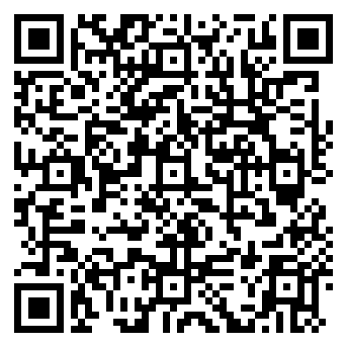

# Apoie o Prep Wiki BR

O Prep Wiki BR é gratuito, de código aberto e sem anúncios. Se ele foi útil para você, uma contribuição ajuda a manter o projeto: tempo para atualizar o catálogo, escrever novas wikis em português e cuidar dos apps.

## PIX

Aponte a câmera do app do seu banco para o QR Code, ou use a chave ou o "copia e cola". Você escolhe o valor.



**Chave PIX (aleatória):**

```
6656db10-157f-4582-bdb8-2f43d0d8e7dd
```

**PIX copia e cola:**

```
00020101021126580014br.gov.bcb.pix01366656db10-157f-4582-bdb8-2f43d0d8e7dd5204000053039865802BR5912Prep Wiki BR6006BRASIL62070503***630421A5
```

## Liberapay

Para apoiar com cartão, de qualquer país, ou com uma contribuição recorrente: [liberapay.com/wdonega](https://liberapay.com/wdonega/donate).

---

Outras formas de ajudar, sem dinheiro: contar para quem possa precisar, [relatar um problema](https://github.com/wdonega/prep-wiki-br/issues) ou sugerir um acervo.
